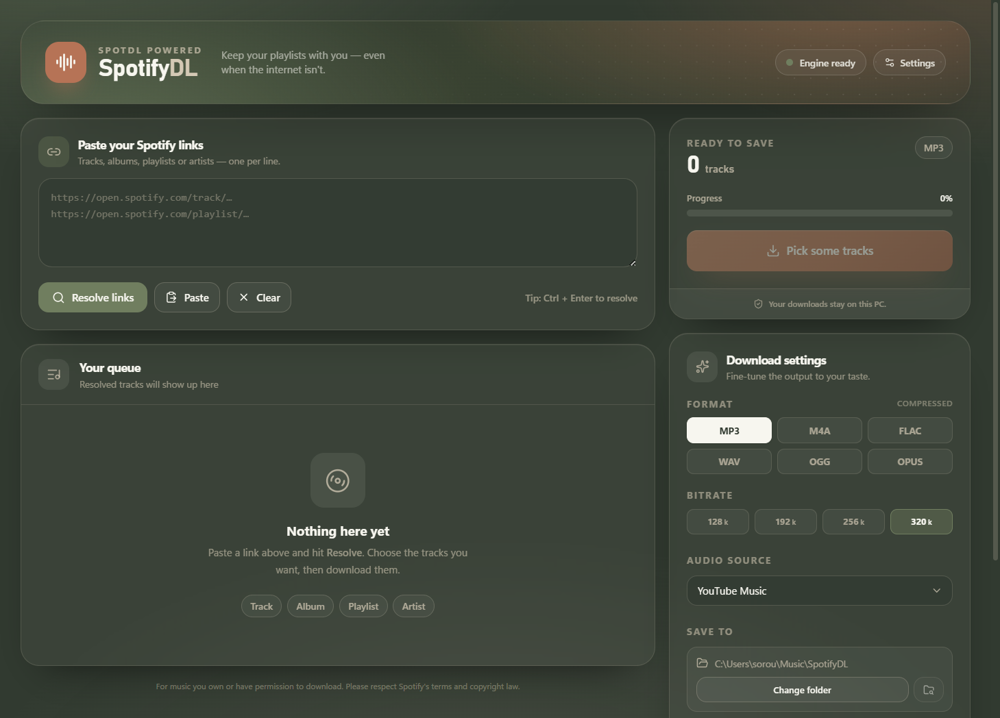
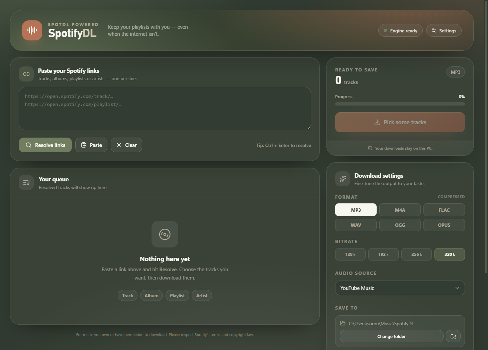
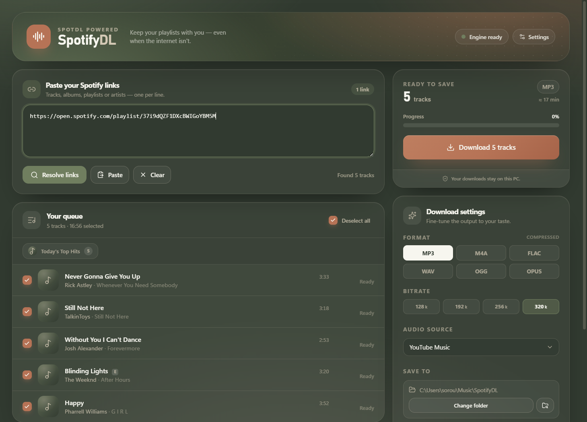

# SpotifyDL

A dark, warm desktop app for downloading Spotify tracks, albums and playlists.  
Built with `spotdl` (Python) + Electron + React.

## Features

- Paste Spotify links (tracks, albums, playlists, artists) and resolve them
- Pick tracks, choose format / bitrate / audio source
- Per-track progress with speed and ETA
- Skip existing files, optional lyrics (.lrc)
- Free Spotify client by default; optional official API with your own credentials
- Portable and NSIS installer

## Palette

| Color | Hex | Role |
|-------|-----|------|
| Forest | `#2E3A2F` | Background / deep text |
| Moss | `#6B7F5B` | Accent / selected / primary actions |
| Sand | `#D9C9B2` | Borders / subtle text |
| Clay | `#C96F4F` | Primary buttons / highlights |
| Cream | `#F8F6EE` | On-dark text / highlights |

## Screenshots

| Idle | Resolved | Downloading | Done |
|------|----------|-------------|------|
|  |  |  |  |

## Install

Grab the latest **NSIS installer** or **portable .exe** from [Releases](https://github.com/Soroush-Eghdami/Spot-dl-electron/releases).

Or build yourself:

```bash
git clone git@github.com:Soroush-Eghdami/Spot-dl-electron.git
cd Spot-dl-electron
npm install
npm run dist          # builds backend exe + electron app + packages
```

Output lands in `release/`:
- `SpotifyDL-Setup-1.0.0.exe` — installer
- `SpotifyDL-portable-1.0.0.exe` — standalone portable

## Dev

```bash
npm run dev           # Electron + Vite dev servers
npm run typecheck     # TS type check (node + web)
npm run build         # production build only (no packaging)
```

The Python backend lives in `backend/` and is bundled via PyInstaller into `backend/dist/spotdl-backend/`. Electron loads it from `resources/backend/` when packaged.

## Requirements

- **Python 3.12+** (bundled via PyInstaller, not needed at runtime)
- **ffmpeg** on PATH (for audio conversion). On Windows, [scoop](https://scoop.sh) `ffmpeg` works.
- Node 22+ for the Electron/React build

## Settings

Stored in `%APPDATA%/SpotifyDL/settings.json`:

| Key | Default |
|-----|---------|
| `outputDir` | `~/Music/SpotifyDL` |
| `format` | `mp3` |
| `bitrate` | `320k` |
| `audioProvider` | `youtube-music` |
| `overwrite` | `skip` |
| `threads` | `4` |
| `generateLrc` | `false` |
| `skipAlbumArt` | `false` |
| `output` | `{artists} - {title}.{output-ext}` |
| `useOfficialApi` | `false` |
| `spotifyClientId` | `""` |
| `spotifyClientSecret` | `""` |

Open **Advanced & Spotify API** in the sidebar to enter your own Spotify Developer credentials for a more reliable (rate-limit free) experience.

## How it works

1. Electron spawns `backend/dist/spotdl-backend/spotdl-backend.exe` once.
2. JSON-lines protocol over stdin/stdout:
   - `{"id": "1", "cmd": "ping"}` → `{"event": "result", "id": "1", "data": {...}}`
   - `{"id": "2", "cmd": "resolve", "urls": [...], "spotify": {...}}` → `{"event": "resolved", ...}`
   - `{"id": "3", "cmd": "download", "urls": [...], "options": {...}, "spotify": {...}}` → progress `track` events + final `complete`
   - `{"id": "4", "cmd": "cancel"}` → stops after current track
   - `{"id": "5", "cmd": "shutdown"}` → clean exit
3. Backend patches `spotapi` with request timeouts and caches GraphQL hashes process-wide.
4. Custom `BridgedSongTracker` feeds real byte progress, speed and ETA to the UI.

## License

MIT — see [LICENSE](LICENSE).

## Credits

- [spotdl](https://github.com/spotDL/spotify-downloader) — the engine
- [yt-dlp](https://github.com/yt-dlp/yt-dlp) — audio sources
- [Electron](https://www.electronjs.org) + [React](https://react.dev) — UI
- Inspired by [yt-electron](https://github.com/Soroush-Eghdami/yt-electron)